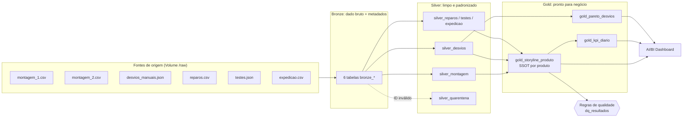

# One Single Flow: rastreabilidade ponta a ponta no Databricks

Pipeline de engenharia de dados em **arquitetura Medallion (Bronze → Silver → Gold)** no **Databricks**, que junta
6 fontes de uma linha de produção numa **fonte única de verdade (SSOT)**: uma visão por produto, da montagem à expedição.

> Projeto de estudo com **dados 100% fictícios**, inspirado num problema real de chão de fábrica: a informação de cada
> produto espalhada em vários sistemas e anotações manuais, o que gera espera, retrabalho e dados que não batem.

**Stack:** Databricks · PySpark · Spark SQL · Delta Lake · Unity Catalog (schemas, volumes, comentários) ·
Lakeflow Jobs · AI/BI Dashboards

---

## Arquitetura

## O que cada camada resolve

| Camada | Notebook | O que faz |
|---|---|---|
| Origem | `01_gerar_dados_ficticios` | Gera 6 fontes com problemas reais de propósito: IDs escritos de 4 jeitos (`" 1000123 "`, `PRD-1000123`...), datas em 2 formatos, duplicidades, descrições digitadas à mão com erros, IDs inválidos |
| Bronze | `02_bronze` | Ingestão **sem alterar nada** (tudo como texto) + `_arquivo_origem` e `_ingerido_em` para rastreabilidade |
| Silver | `03_silver` | ID único por produto, datas convertidas com `try_to_timestamp`, deduplicação com `row_number`, **texto livre → código padrão** via tabela de sinônimos, **quarentena** para registros inválidos |
| Gold | `04_gold` | `gold_storyline_produto` (uma linha por produto com todo o histórico e status atual), KPIs diários (First Pass Yield, taxa de reparo, lead time) e Pareto de desvios |
| Qualidade | `05_qualidade_dados` | 7 regras automáticas (unicidade, nulos, ordem das datas, integridade referencial, % de quarentena...). Regra crítica falhou → o Job para |
| Consumo | `06_consultas_dashboard.sql` | Consultas prontas para o AI/BI Dashboard |

## Resultados (dados fictícios, semente fixa)

- **6 fontes** e cerca de **6.500 registros brutos** consolidados em **1.500 produtos**, 1 linha por produto
- **10 registros** com ID inválido isolados em quarentena (em vez de sumirem em silêncio)
- Descrições digitadas à mão classificadas automaticamente: **6,2% sem padrão**, sinalizados para revisão
- **7/7 regras de qualidade** aprovadas, com histórico em `dq_resultados`
- Pipeline completo (Bronze → Silver → Gold → Qualidade) orquestrado num **Lakeflow Job** em **2min35s**
- KPIs do período: First Pass Yield de **71,4%**, taxa de reparo de **17,4%**, lead time médio de **47,4h** e **1.159 produtos expedidos**

**Job orquestrando as 4 camadas:**

**Filtro global por linha de produção (L2):** o filtro se aplica aos gráficos e à tabela. Os KPIs do topo mostram o período completo, porque vêm de um dataset já agregado (próximo passo: calculá-los direto da `gold_storyline_produto` para responderem ao filtro).

## Decisões técnicas

- **Bronze só com texto:** inferir tipos na entrada esconde erros; a conversão acontece na Silver, onde dá para tratar e medir.
- **`try_to_timestamp` e `try_cast`:** o serverless roda em modo ANSI, em que uma conversão inválida derruba o pipeline. As funções `try_` devolvem nulo, e a regra de qualidade mede quantos nulos surgiram.
- **Quarentena em vez de descarte:** registro com problema fica visível para ser corrigido na origem.
- **Código pelo ID, não pela descrição:** a descrição digitada muda (erros de digitação); a tabela de sinônimos liga o texto a um código estável e cresce conforme novos padrões aparecem.
- **Qualidade como etapa do pipeline:** é melhor o Job falhar do que publicar dado errado no dashboard.

## Como rodar (Databricks Free Edition, gratuito)

1. Crie uma conta em **databricks.com/learn/free-edition**.
2. **Workspace → Create → Git folder** e cole a URL deste repositório (ou **Import** dos arquivos da pasta `notebooks`).
3. Rode os notebooks em ordem: `00_setup` → `01` → `02` → `03` → `04` → `05`.
4. **Jobs & Pipelines → Create job** com 4 tarefas encadeadas: `02_bronze` → `03_silver` → `04_gold` → `05_qualidade_dados`.
5. **Dashboards → Create dashboard** e use as consultas de `06_consultas_dashboard.sql` como datasets.

Se o catálogo do seu workspace não se chamar `workspace`, troque no widget `catalog` de cada notebook.

## Próximos passos

- Ingestão incremental com **Auto Loader** e `MERGE INTO` (hoje é carga completa)
- Reescrever como **Lakeflow Declarative Pipeline** com *expectations* nativas de qualidade
- Espaço **Genie** sobre as tabelas Gold para perguntas em linguagem natural

---

**Autor:** Carlos Eduardo da Silva Lima · [LinkedIn](https://linkedin.com/in/eduardolima19) · [GitHub](https://github.com/Edu1910-sl)
